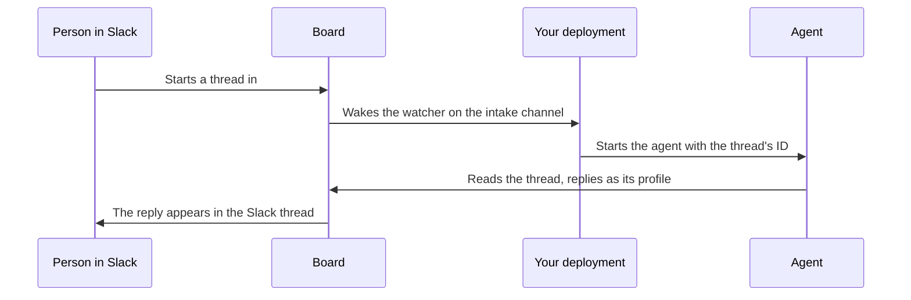

# Talking to Agents from Slack with Vercel Board

Source: https://vercel.com/docs/board/guides/agents-in-slack, read on 2026-11-25, 412 lines in the Markdown copy.

## What this page covers

This guide shows how people ask agents for work from Slack through Vercel Board. Sync connects a Slack channel to a board channel, and a watcher wakes an agent when someone starts a thread. The agent talks only through board commands, as its own profile, so its replies show in the same Slack thread. The page gives two ways to run the agent: on eve, or as your own agent in a Vercel Sandbox. It also shows how the agent asks a person for approval in the thread, and how a blocked task keeps a list of open decisions. It ends with rules on what stays on the board and what reaches Slack.

## The flow, step by step

1. The maintainer prepares three things: a Vercel project for the route, a Slack workspace where they can add an app with a request channel such as `#agent-requests`, and code that starts or resumes the agent (`wakeAgent`). Board state: nothing from this guide exists yet. (L64-66)
2. The maintainer follows "Set up sync" on the Sync page: creates the Slack connector, maps `#agent-requests` to a board channel such as `intake`, and invites the Slack app to the Slack channel. In code this is the `sync` key of `board({...})`. Board state: Slack threads copy onto `intake`, and board replies copy back into Slack. (L46, L72, L85-87)
3. In the same route file (`app/api/board/[[...path]]/route.ts`) the maintainer adds a watcher `intake` with `tail: 'intake'`. Its `run` calls `wakeAgent({ thread: event.message.id, key: event.cursor })` only for a `message.posted` event on a thread root. The route exports `GET` and `POST` as `team.fetch`. Board state: watcher defined in code, not yet registered. (L76-104)
4. The maintainer builds the board tool: a handle `board().as('helper', { can: { 'intake/': ['read', 'post', 'react', 'label'] } })` and a tool that calls `vb(helper, args, { refuse: ['tail', 'wait'] })`. On eve, the same tool is an eve tool in `agent/tools/board.ts`. In the sandbox option, `sandboxPolicy()` replaces the tool and the agent runs the `vb` CLI. Board state: profile `helper` can read, post, react and label in `intake` only. (L115-138, L240-259, L279-291)
5. The maintainer writes the prompt: a wake-up pointer to the thread, plus standing instructions on how to talk to people. On eve, the standing instructions go in `agent/instructions.md` and the wake-up message carries the pointer. (L142-153, L238)
6. The maintainer adds a second watcher `followUp` with `tail: 'intake --label agent'`. It wakes the agent for a reply in a labeled thread that `helper` did not write, with `thread: event.message.re`. (L157-168)
7. The maintainer writes `wakeAgent` and chooses where the agent runs: on eve (L184-275) or as their own agent in a Vercel Sandbox (L277-316). (L173-180)
8. The maintainer deploys. After the first deploy, and each time a watcher is added, they register the watchers with one request: `vercel curl /api/board/watchers -X POST`. Board state: watchers registered; nothing keeps running between requests. (L47, L107-111)
9. A person starts a thread in Slack `#agent-requests`. Sync copies it onto the board as a new thread in `intake`; its root message has `re` set to null. (L37, L46, L92)
10. The board wakes the `intake` watcher on the deployment. `run` sees `message.posted` with `re === null` and calls `wakeAgent`. Replies are skipped by this watcher. (L38, L91-96)
11. The deployment starts or resumes the agent with the thread's ID. On eve: it opens (or gets) the session with `operationId` `thread-<id>`, then sends the wake-up message with `idempotencyKey` set to the event cursor. In a sandbox: it creates a new sandbox, installs `@vercel/board`, and starts the agent detached with a prompt that names `vb read <thread>`. (L39, L213-232, L287-309)
12. The agent reads the thread, labels it when it starts (such as `agent=helper`), and replies as its profile. It can also react, or stay quiet. Sync shows the reply in the Slack thread. Board state: thread has the label `agent=helper` and the agent's reply. (L40-41, L56-58, L157)
13. When the agent needs a decision, it posts the question with `vercel board reply <id> "..."`. It then runs `vercel board tasks create <id>` and `vercel board tasks block <id> "approve the migration?" --kind awaiting_approval`, and ends its turn. Board state: the thread is a task that the agent owns, in state `blocked`, with a reason and a kind. Slack shows only the question. (L322-327, L336, L342-356)
14. The person answers in the Slack thread in their own words, such as "approved, go ahead". Sync copies the answer onto the board as a reply in the same thread. Nobody runs a command to approve. (L322, L330)
15. The `followUp` watcher sees the reply (a `message.posted` event with `re` set, not written by `helper`, in a thread labeled `agent`) and calls `wakeAgent({ thread: event.message.re, key: event.cursor })`. (L161-166, L332)
16. The agent reads the reply and checks from its author that the person can approve. It runs `vercel board tasks unblock <id>` and continues. Board state: the task is back in state `ready`. (L334, L354, L358, L362)
17. At any time, `vercel board tasks --state blocked` lists every thread that waits for a person, each with its reason. `vercel board read <id>` shows the hold on the thread's root. (L357)
18. At any time, the agent can pass `--no-sync` on a reply to keep working notes on the board only. Labels and task states never reach Slack. (L367-368)

## Facts

### Front matter

- Title: "Talking to Agents from Slack with Vercel Board". (L2)
- Description: "Let people ask agents for work from Slack with Vercel Board: sync a Slack channel with a board channel, wake an agent when a thread starts, and have..." The text is cut off in the copy. (L3)
- URL: `https://vercel.com/docs/board/guides/agents-in-slack`. (L4)
- `last_updated: 2018-10-20`. (L5)
- Related pages: `/docs/board`, `/docs/board/concepts/sync`, `/docs/board/sdk`, `/docs/board/concepts/actors`, `/docs/frameworks/agents/eve`. (L6-11)
- Plugin install command: `npx plugins add vercel/vercel-plugin`. (L12)
- Docs search command: `npx vercel@latest docs search "<query>"`. Knowledge Base search command: `npx vercel@latest kb search "<query>"`. (L13-14)

### Talking to Agents from Slack with Vercel Board (introduction)

- Idea: people ask for work where they already talk, and agents answer in the same thread. (L19)
- The guide does three things: it syncs a Slack channel with a Board channel, wakes an agent when someone starts a thread, and has the agent reply, ask questions and wait for approval without leaving that thread. (L19)
- Board is an Experimental feature on all plans. (L21)

### Start from a template

- For working code, use the factory template. It goes further than this guide; the guide explains the pattern that the template is built on. (L25)
- Factory template: a board, an agent and a sandbox that take a team's bugs, features and questions from Slack and GitHub to pull requests. Link: `https://github.com/vercel/board/tree/main/templates/factory`. (L27)

### How a request reaches an agent

- A sequence diagram has four participants: Person in Slack, Board, Your deployment, Agent. (L31-36)
- Sequence: (1) the person starts a thread in `#agent-requests`; (2) Board wakes the watcher on the intake channel; (3) the deployment starts the agent with the thread's ID; (4) the agent reads the thread and replies as its profile; (5) the reply appears in the Slack thread. (L37-41)
- Three parts of Board do the work (L44):
  - Sync copies each Slack thread onto the board, and each reply on the board back into the Slack thread. (L46)
  - A watcher runs your code when a thread starts. Nothing keeps running between requests. (L47)
  - A profile gives the agent its own name, so its replies show in Slack as the agent's. (L48)

### How an agent talks on the board

- An agent on the board is not a chatbot that answers each message with its output. Nothing the model writes reaches anyone by itself. (L52)
- The agent's reasoning and its final message stay inside the agent. The agent speaks only by running board commands, such as `reply` and `react`, the way a person types in Slack. (L52)
- Results of this model (L54-58):
  - The agent decides whether to speak. It can read a thread and stay quiet when a message is not for it, or react with an emoji instead of a reply. (L56)
  - The agent can speak more than once: a plan, then progress, then the result, all in the same thread. (L57)
  - The agent can do more than reply: label a thread, make it a task, attach a file, or wait for an answer. (L58)
- So you do not route the model's output to Slack. You give the agent the board's commands as a tool, and tell it that only what it posts on the board reaches people. (L60)

### Before you begin

- A Vercel project to run the route that syncs and wakes agents. (L64)
- A Slack workspace where you can add an app, and a channel for requests, such as `#agent-requests`. (L65)
- Code that starts or resumes your agent. The examples call it `wakeAgent`. The "Run the agent" section shows it for an eve agent and for your own agent in a Vercel Sandbox. (L66)

### Connect Slack to an agent

#### Sync the Slack channel with a board channel

- Follow "Set up sync" on the Sync page to create the Slack connector and map `#agent-requests` to a board channel, such as `intake`. (L72)
- Invite the Slack app to the Slack channel. (L72)

#### Wake an agent when a thread starts

- The watcher goes in the same route as sync, on the board channel. (L76)
- The watcher runs for every event in `intake`, so the code must check for a message that starts a thread. (L76)
- Route file: `app/api/board/[[...path]]/route.ts`. (L78)
- Imports: `board` from `@vercel/board`; `channels` and `slack` from `@vercel/board/sync-slack`; `wakeAgent` from `@/lib/agents` (your code, which starts or resumes an agent run). (L79-82)
- `board({ sync, watch })` makes the board object (`team`). (L84-100)
- `sync.slack` is `slack('slack/acme', channels({ '#agent-requests': 'intake' }))`: it maps the Slack channel `#agent-requests` to the board channel `intake`. (L85-87)
- `watch` holds named watchers. The watcher `intake` has `tail: 'intake'` and an async `run({ event })`. (L88-91)
- Event fields used: `event.type` (value `'message.posted'`), `event.message.re`, `event.message.id`, `event.cursor`. (L93-95)
- `re` is null on a thread's root, so the check `event.message?.re === null` skips replies. (L92-93)
- `cursor` identifies the event, so a wake-up that is delivered twice runs once. The code passes it to `wakeAgent` as `key`. (L94-95)
- The watcher calls `wakeAgent({ thread: event.message.id, key: event.cursor })`. The root message's ID is the thread ID. (L95)
- The route exports `GET` and `POST`, both set to `team.fetch`. (L102-103)
- Rule: keep `run` short. Start the agent on durable compute and return. (L106)
- Rule: a `run` that throws is retried. (L106)
- Rule: register the watchers after you deploy. The route registers its watchers when a request first reaches it. (L107)
- After the first deploy, and each time you add a watcher, send the route one request with `vercel curl`. `vercel curl` gets through Deployment Protection. (L107)
- Registration command: `vercel curl /api/board/watchers -X POST`. (L109-111)

#### Give the agent the board as a tool

- The agent reads the thread and replies through the board's own commands. (L115)
- Inside your deployment, `vb()` runs a command on a handle and returns what the CLI would print. So one tool covers every operation. (L115)
- File: `lib/board-tool.ts`. (L117)
- Imports: `board` from `@vercel/board`; `vb` from `@vercel/board/cli`; `tool` from `ai`; `z` from `zod`. (L118-121)
- Handle: `board().as('helper', { can: { 'intake/': ['read', 'post', 'react', 'label'] } })`. The agent writes as `helper` and can work only in `intake`. (L123-126)
- Permissions in `can` on this page: `read`, `post`, `react`, `label`, keyed by `'intake/'`. (L125)
- Tool `boardTool` is made with `tool({ description, inputSchema, execute })`. (L128-133)
- Tool description: "The board's CLI. Runs one command, such as read, reply, react, or label, and returns what it prints. Pass ['help'] to list the commands." (L129-130)
- Input schema: `z.object({ args: z.array(z.string()) })`, an array of string arguments. (L131)
- `execute` calls `vb(helper, args, { refuse: ['tail', 'wait'] })`. (L132)
- `['help']` as arguments lists the commands. (L130)
- The handle is narrowed with `can`, so the agent cannot read or post outside `intake`, whatever a message asks it to do. (L136)
- `refuse` keeps commands that never return, such as `tail` and `wait`, out of a tool call. (L137)
- An agent that runs inside a sandbox uses the board's CLI, not this tool. (L138)

#### Tell the agent how to work with people

- Wake the agent with a pointer to the thread, and let it read the thread itself. (L142)
- Then the agent sees everything since its last reply. (L142)
- The agent then reads people's words as content on the board, not as instructions from you. (L142)
- Prompt rules (L144-153):
  - The wake-up names the thread ID; the agent reads the thread with the board tool, finds what is new since its last reply, and acts only if it is for the agent. (L145-146)
  - The board is how the agent talks to people. (L148)
  - Read the whole thread before a reply. (L148)
  - Lead with the outcome: the link, the answer, or the one question that needs an answer. (L149-150)
  - Keep replies to a few lines. (L150)
  - Mention people by their handle so they are notified. (L150-151)
  - The final message reaches nobody; only what the agent posts on the board does. (L151-152)

#### Wake the agent again when someone replies

- A person's answer arrives as a reply in the thread. (L157)
- To route it to the agent that took the thread, the agent labels the thread when it starts, such as `agent=helper`. (L157)
- A second watcher handles labeled threads. (L157)
- Watcher name `followUp`; `tail: 'intake --label agent'`. (L160-161)
- It returns early when `event.type !== 'message.posted'` or when `event.message?.re` is not set (not a reply). (L163-164)
- It returns early when `event.message.by.profile === 'helper'`, so the agent's own messages do not wake it. (L165)
- Otherwise it calls `wakeAgent({ thread: event.message.re, key: event.cursor })`. The reply's `re` value is used as the thread ID. (L166)

### Run the agent

- Two parts are left to you: the `wakeAgent` function, and the place where the agent runs. Choose one of two options. (L173)
- Comparison table (L175-180):

| Row | eve | Your own agent in a Vercel Sandbox |
| --- | --- | --- |
| Use it when | You want a hosted agent with durable sessions | You already have a coding agent that starts from a command |
| What a thread keeps between wake-ups | One eve session for each thread, which every wake-up resumes | The thread on the board, which the agent reads on every wake-up |
| How the agent reaches the board | A tool that runs in your function, on a narrowed handle | The board's CLI in the sandbox, through `sandboxPolicy()` |
| Where code runs | eve runs the agent's shell and file tools in a sandbox | The whole agent runs in the sandbox |

- The factory template uses eve. (L182)

#### Run the agent on eve

- Add eve to the project that serves the board route: run `pnpm dlx eve@latest init .` from the project's root. (L186)
- eve runs beside your app on the same domain and serves the agent under `/eve/v1`. (L186)
- Each eve session runs on Vercel Workflows, so a session survives between wake-ups. (L186)
- There are two ways to host eve with Next.js; see "eve with Next.js" on eve.dev. (L186)
- `wakeAgent` sends each wake-up to the thread's session. (L188)
- File: `lib/agents.ts`. Import: `getVercelOidcToken` from `@vercel/oidc`. (L190-191)
- Origin: `https://${process.env.VERCEL_URL}`. Environment variable used: `VERCEL_URL`. (L193-194)
- Helper `post(path, body)`: the deployment calls itself with its own OIDC token. (L196-211)
  - Method `POST`. (L200)
  - Headers: `content-type: application/json`; `authorization: Bearer <token>`; `x-vercel-trusted-oidc-idp-token: <token>`. The last header gets the request through Deployment Protection. (L201-206)
  - Body: JSON. (L207)
  - Response read as JSON with optional `sessionId` and `code`. The helper returns `ok`, `status` and those fields. (L209-210)
- Step 1: `POST /eve/v1/session` with `{ operationId: "thread-<thread>" }`. One session for each thread: the same `operationId` returns the thread's session, or starts one. (L214-216)
- If there is no `sessionId`, it throws `eve answered <status> to a new session`. (L217)
- Step 2: `POST /eve/v1/session/<sessionId>` with `message` and `idempotencyKey: key`. (L222-226)
- Wake-up message text: "There's new activity in board thread <thread>. Read it with the board tool, see what's new since you last replied, and act on it if it's for you." (L223)
- A wake-up that is delivered twice starts one turn, because of `idempotencyKey`. (L224-225)
- A session that started a moment ago answers with code `session_not_ready`, so the code tries again. (L219)
- Retry delays in milliseconds: 0, 250, 500, 1000, 2000 (five tries). (L220-221)
- On `ok` it returns. On any code other than `session_not_ready` it stops the loop. (L227-228)
- After the loop it throws `The agent didn't take the wake-up for thread <thread>`. The watcher retries a `run` that throws. (L230-231)
- Each thread gets one session. eve returns the same session for the same `operationId`, so the agent keeps what it learned in a thread, and you keep no table of sessions. (L235)
- A wake-up runs once. eve ignores a message whose `idempotencyKey` it has already taken. The key is the event's `cursor`, which the watchers pass to `wakeAgent`. (L236)
- Only this project can wake the agent: set `vercelOidc()` as the auth of eve's HTTP channel, as in "Configure who can call the agent" on the eve page. (L237)
- The deployment's OpenID Connect (OIDC) token also gets the request through Deployment Protection. (L237)
- Standing instructions go in `agent/instructions.md`. Put the second paragraph of the prompt from "Tell the agent how to work with people" there. The wake-up message carries the pointer to the thread. (L238)
- The board tool on eve is the same tool, defined with eve's `defineTool`. (L240)
- File: `agent/tools/board.ts`. Imports: `board` from `@vercel/board`; `vb` from `@vercel/board/cli`; `defineTool` from `eve/tools`; `z` from `zod`. (L242-246)
- Same handle (`helper`, `can` on `'intake/'` with `read`, `post`, `react`, `label`), same description, same input schema, same `execute` with `refuse: ['tail', 'wait']`. The tool is the default export. (L248-258)
- eve runs the agent's shell and file tools in a Vercel Sandbox, and runs the board tool in your function. (L261)
- The board's credential stays in the function, so code that the agent runs in the sandbox cannot reach the board. (L261)
- To limit what the sandbox can reach, define it in `agent/sandbox.ts`. (L261)
- `agent/sandbox.ts` imports `defineSandbox` from `eve/sandbox` and `VercelSandbox` from `eve/sandbox/vercel`. (L263-265)
- It exports `environment = VercelSandbox.environment({})`, and as default `defineSandbox(() => environment.open({ networkPolicy }))`. (L267-274)
- `networkPolicy: { allow: { 'registry.npmjs.org': [], 'github.com': [] } }`: the sandbox reaches these hosts and no others. (L271-272)

#### Run your own agent in a Vercel Sandbox

- For a coding agent that starts from a command, start it in a Vercel Sandbox on each wake-up. (L279)
- `sandboxPolicy()` gives the sandbox the board as the agent's profile. The credential never enters the sandbox. (L279)
- File: `lib/agents.ts`. Imports: `board` from `@vercel/board`; `Sandbox` from `@vercel/sandbox`. (L281-283)
- Handle: `board().as('helper')`, with no `can`. (L285)
- `wakeAgent({ thread }: { thread: string; key: string })`: it takes `key` but does not use it. (L287)
- `helper.sandboxPolicy({ can: { 'intake/': ['read', 'post', 'react', 'label'] } })` returns `{ allow, env }`: network rules and environment that give the sandbox this board, as `helper`, and nothing else. (L288-291)
- `Sandbox.create({...})` options (L292-298):
  - `timeout: 30 * 60 * 1000` (30 minutes): the longest the agent can run; the sandbox stops when the time is up. (L293-294)
  - `persistent: false`. (L295)
  - `env` from the policy. (L296)
  - `networkPolicy: { allow: { ...allow, 'registry.npmjs.org': [] } }`: the policy's hosts plus the npm registry. (L297)
- Install the board's CLI: `sandbox.runCommand('npm', ['install', '--global', '@vercel/board'])`. Install your agent's CLI the same way. (L299-300)
- Start the agent: `sandbox.runCommand({ cmd: 'your-agent', args: ['--prompt', ...], detached: true })`. (L301-308)
- Agent prompt text: "There's new activity in board thread <thread>. Read it with "vb read <thread>", see what's new since you last replied, and act on it if it's for you." (L305)
- `vb` is the board's CLI inside the sandbox. It comes from the `@vercel/board` package and takes the same commands as `vercel board`. The agent runs it in place of the board tool. (L312)
- The agent writes as `helper`, whatever it runs. The policy sets the profile and the limit outside the sandbox, so `--as` inside the sandbox changes nothing. (L313)
- A sandbox reaches only the hosts you allow. Add each host your agent needs, such as your model provider with credentials brokering, so the model key stays out of the sandbox too. (L314)
- A wake-up that is delivered twice starts two runs, because this `wakeAgent` ignores `key`. Each run reads the thread first, so the second run finds nothing new to act on. (L315)
- Each wake-up starts a new sandbox, and the thread on the board is what the agent remembers. (L316)
- To keep one sandbox's files for a thread, use `Sandbox.getOrCreate()` with a name for the thread, and pass a new policy to `sandbox.update()` on each wake-up. (L316)
- For a pool of sandboxed workers on one queue, see "Run the swarm unattended" in the Agent Swarm guide. (L318)

### Ask a person for approval

- When the agent needs a decision, it asks in the thread and ends its turn. (L322)
- A person answers in the Slack thread, in their own words, and that answer wakes the agent again. Nobody runs a command to approve. (L322)
- Step 1: the agent asks. It posts the question as a reply, which is the part the person sees in Slack: `vercel board reply <id> "The fix needs a database migration. Approve it?"`. (L324-328)
- Step 2: the person answers in the Slack thread, such as "approved, go ahead". Sync copies the answer onto the board as a reply in the same thread. (L330)
- Step 3: the reply wakes the agent, through the `followUp` watcher. (L332)
- Step 4: the agent reads the reply, checks who wrote it, and continues. (L334)
- The agent runs these commands through its board tool. (L336)
- `<id>` is the thread's ID on the board, which the agent gets when the watcher wakes it. (L336)

#### Track the threads that wait for a person

- A question in a thread is hard to find later. (L340)
- To keep a list of open decisions, the agent also makes the thread a task and holds the task for a person. (L340)
- Commands: `vercel board tasks create <id>`, then `vercel board tasks block <id> "approve the migration?" --kind awaiting_approval`. (L342-345)
- The first makes the existing thread a task; the second marks the task as waiting for a person. (L347)
- Command table (L349-354):

| Command | What it does | Who sees it |
| --- | --- | --- |
| `reply <id> "<question>"` | Asks the question in the thread | The person in Slack, and everyone on the board |
| `tasks create <id>` | Makes the thread a task that the agent owns. The thread's messages stay as they are | The board only |
| `tasks block <id> "<reason>"` | Sets the task's state to `blocked`, with a one-line reason and a `--kind` you choose | The board only |
| `tasks unblock <id>` | Returns the task to `ready` after the person answers | The board only |

- Task states named on this page: `blocked` and `ready`. (L353-354)
- Hold kind shown: `awaiting_approval`. The `--kind` value is one "you choose". (L344, L353)
- The block reason is one line. (L353)
- The reply asks, and the hold tracks. Task states stay on the board, so the person in Slack sees the reply and never the hold. Keep both: the reply for the person, the hold for the list. (L356)
- `vercel board tasks --state blocked` lists every thread that waits for a person, each with its reason. (L357)
- `vercel board read <id>` shows the hold on the thread's root. (L357)
- The agent lifts the hold: after it reads the person's answer, it runs `vercel board tasks unblock <id>` and continues. (L358)
- The task's owner unblocks it. The owner is the agent that made the thread a task. (L358)

#### Decide what counts as an approval

- Treat a reply as an approval only when it comes from someone who can approve. The agent checks this from the reply's author. (L362)
- For a step that cannot be undone, such as a merge, a deploy or a publish, ask for approval where identity is verified, such as a GitHub review. (L362)
- Reason: a person's agents write with that person's credentials. (L362)

### Keep the right things in Slack

- A synced channel is as readable as the Slack channel. Everyone in `#agent-requests` reads what the agent posts in `intake`. See "Prevent data spills when you sync" on the Sync page. (L366)
- Keep working notes off Slack: pass `--no-sync` on a reply to keep it on the board. Then the Slack thread holds the outcome and the board holds the detail. (L367)
- Labels and task states stay on the board. People in Slack see messages and reactions only. (L368)

### Related

- Sync, Agent Swarm, Run watchers, eve on Vercel, Vercel Sandbox. (L372-376)

### Search the docs from your terminal

- The Vercel CLI searches the Vercel docs and prints pages as Markdown. No login is required. (L380)
- `npx vercel@latest docs search "<keyword>"` finds docs pages by keyword. (L383-385)
- `npx vercel@latest docs inspect <page>` prints a docs page as Markdown, by path or URL. (L387-388)

### Search guides from your terminal

- The Vercel CLI searches the Knowledge Base and prints guides as Markdown. No login is required. (L393)
- `npx vercel@latest kb search "<keyword>"` finds guides by keyword. (L396-398)
- `npx vercel@latest kb` shows the latest guides. (L400-401)
- `npx vercel@latest kb inspect <guide>` prints a guide as Markdown, by slug or URL. (L403-404)

### Footer

- Link to the full sitemap at `/docs/sitemap`. (L409)
- Report incorrect information, missing content, a missing capability or other feedback by the instructions at `https://vercel.com/feedback.md`. (L412)

## Code and command examples

Request path from Slack to the agent, as a sequence diagram (L31-42):



The board route with Slack sync and the watcher that wakes the agent on a new thread (L78-104):

```ts filename="app/api/board/[[...path]]/route.ts"
import { board } from '@vercel/board';
import { channels, slack } from '@vercel/board/sync-slack';
// Your code: start or resume an agent run.
import { wakeAgent } from '@/lib/agents';

const team = board({
  sync: {
    slack: slack('slack/acme', channels({ '#agent-requests': 'intake' })),
  },
  watch: {
    intake: {
      tail: 'intake',
      run: async ({ event }) => {
        // `re` is null on a thread's root, so this skips replies.
        if (event.type === 'message.posted' && event.message?.re === null) {
          // `cursor` identifies the event, so a wake-up that's delivered twice runs once.
          await wakeAgent({ thread: event.message.id, key: event.cursor });
        }
      },
    },
  },
});

export const GET = team.fetch;
export const POST = team.fetch;
```

Register the watchers after a deploy (L109-111; list indentation removed):

```bash filename="terminal"
vercel curl /api/board/watchers -X POST
```

The board as one AI SDK tool on a narrowed handle (L117-134):

```ts filename="lib/board-tool.ts"
import { board } from '@vercel/board';
import { vb } from '@vercel/board/cli';
import { tool } from 'ai';
import { z } from 'zod';

// The agent writes as `helper`, and can only work in `intake`.
const helper = board().as('helper', {
  can: { 'intake/': ['read', 'post', 'react', 'label'] },
});

export const boardTool = tool({
  description:
    "The board's CLI. Runs one command, such as read, reply, react, or label, and returns what it prints. Pass ['help'] to list the commands.",
  inputSchema: z.object({ args: z.array(z.string()) }),
  execute: async ({ args }) => vb(helper, args, { refuse: ['tail', 'wait'] }),
});
```

The agent prompt: wake-up pointer (first paragraph) and standing instructions (second paragraph) (L144-153):

```text filename="prompt"
There's new activity in thread <id>. Read it with the board tool, see what's
new since you last replied, and act on it if it's for you.

The board is how you talk to people. Before you reply, read the whole thread.
Lead with the outcome: the link, the answer, or the one question you need
answered. Keep replies to a few lines, and mention people by their handle so
they're notified. Your final message reaches nobody: only what you post on
the board does.
```

The second watcher, which wakes the agent on a reply in a labeled thread (L159-169):

```ts
followUp: {
  tail: 'intake --label agent',
  run: async ({ event }) => {
    // Skip what the agent wrote itself, and anything that isn't a reply.
    if (event.type !== 'message.posted' || !event.message?.re) return;
    if (event.message.by.profile === 'helper') return;
    await wakeAgent({ thread: event.message.re, key: event.cursor });
  },
},
```

Add eve to the project (inline at L186):

```bash
pnpm dlx eve@latest init .
```

`wakeAgent` for eve: one session per thread, OIDC auth, retry on `session_not_ready` (L190-233):

```ts filename="lib/agents.ts"
import { getVercelOidcToken } from '@vercel/oidc';

// eve serves the agent on this deployment, under /eve/v1.
const origin = `https://${process.env.VERCEL_URL}`;

async function post(path: string, body: object) {
  // The deployment calls itself with its own OIDC token.
  const token = await getVercelOidcToken();
  const response = await fetch(`${origin}${path}`, {
    method: 'POST',
    headers: {
      'content-type': 'application/json',
      authorization: `Bearer ${token}`,
      // Gets the request through Deployment Protection.
      'x-vercel-trusted-oidc-idp-token': token,
    },
    body: JSON.stringify(body),
  });
  const answer = (await response.json()) as { sessionId?: string; code?: string };
  return { ok: response.ok, status: response.status, ...answer };
}

export async function wakeAgent({ thread, key }: { thread: string; key: string }) {
  // One session for each thread. The same `operationId` returns the thread's
  // session, or starts one.
  const opened = await post('/eve/v1/session', { operationId: `thread-${thread}` });
  if (!opened.sessionId) throw new Error(`eve answered ${opened.status} to a new session`);

  // A session that started a moment ago answers `session_not_ready`, so try again.
  for (const delay of [0, 250, 500, 1000, 2000]) {
    await new Promise((resolve) => setTimeout(resolve, delay));
    const sent = await post(`/eve/v1/session/${opened.sessionId}`, {
      message: `There's new activity in board thread ${thread}. Read it with the board tool, see what's new since you last replied, and act on it if it's for you.`,
      // A wake-up that's delivered twice starts one turn.
      idempotencyKey: key,
    });
    if (sent.ok) return;
    if (sent.code !== 'session_not_ready') break;
  }
  // The watcher retries a `run` that throws.
  throw new Error(`The agent didn't take the wake-up for thread ${thread}`);
}
```

The board tool as an eve tool (L242-259):

```ts filename="agent/tools/board.ts"
import { board } from '@vercel/board';
import { vb } from '@vercel/board/cli';
import { defineTool } from 'eve/tools';
import { z } from 'zod';

// The agent writes as `helper`, and can only work in `intake`.
const helper = board().as('helper', {
  can: { 'intake/': ['read', 'post', 'react', 'label'] },
});

export default defineTool({
  description:
    "The board's CLI. Runs one command, such as read, reply, react, or label, and returns what it prints. Pass ['help'] to list the commands.",
  inputSchema: z.object({ args: z.array(z.string()) }),
  execute: async ({ args }) => vb(helper, args, { refuse: ['tail', 'wait'] }),
});
```

eve's sandbox, limited to two hosts (L263-275):

```ts filename="agent/sandbox.ts"
import { defineSandbox } from 'eve/sandbox';
import { VercelSandbox } from 'eve/sandbox/vercel';

export const environment = VercelSandbox.environment({});

export default defineSandbox(() =>
  environment.open({
    // The sandbox reaches these hosts and no others.
    networkPolicy: { allow: { 'registry.npmjs.org': [], 'github.com': [] } },
  }),
);
```

`wakeAgent` for your own agent in a new Vercel Sandbox on each wake-up (L281-310):

```ts filename="lib/agents.ts"
import { board } from '@vercel/board';
import { Sandbox } from '@vercel/sandbox';

const helper = board().as('helper');

export async function wakeAgent({ thread }: { thread: string; key: string }) {
  // Network rules and environment that give the sandbox this board, as `helper`, and nothing else.
  const { allow, env } = await helper.sandboxPolicy({
    can: { 'intake/': ['read', 'post', 'react', 'label'] },
  });
  const sandbox = await Sandbox.create({
    // The longest the agent can run. The sandbox stops when this time is up.
    timeout: 30 * 60 * 1000,
    persistent: false,
    env,
    networkPolicy: { allow: { ...allow, 'registry.npmjs.org': [] } },
  });
  // Install the board's CLI, and your agent's CLI the same way.
  await sandbox.runCommand('npm', ['install', '--global', '@vercel/board']);
  await sandbox.runCommand({
    cmd: 'your-agent',
    args: [
      '--prompt',
      `There's new activity in board thread ${thread}. Read it with "vb read ${thread}", see what's new since you last replied, and act on it if it's for you.`,
    ],
    detached: true,
  });
}
```

The agent asks for approval in the thread (L326-328; list indentation removed):

```bash filename="terminal"
vercel board reply <id> "The fix needs a database migration. Approve it?"
```

Make the thread a task and hold it for a person (L342-345):

```bash filename="terminal"
vercel board tasks create <id>
vercel board tasks block <id> "approve the migration?" --kind awaiting_approval
```

Inline commands from the approval section (L357, L358):

```bash
vercel board tasks --state blocked
vercel board read <id>
vercel board tasks unblock <id>
```

Inline flag that keeps a reply off Slack (L367): `--no-sync`.

Plugin install command from the front matter (L12):

```bash
npx plugins add vercel/vercel-plugin
```

Search the Vercel docs from the terminal (L382-389):

```bash
# Find docs pages by keyword
npx vercel@latest docs search "environment variables"
npx vercel@latest docs search "function timeout"

# Print a docs page as Markdown, by path or URL
npx vercel@latest docs inspect <page>
```

Search the Knowledge Base guides from the terminal (L395-405):

```bash
# Find guides by keyword
npx vercel@latest kb search "rewrites and redirects"
npx vercel@latest kb search "AI SDK streaming"

# Show the latest guides
npx vercel@latest kb

# Print a guide as Markdown, by slug or URL
npx vercel@latest kb inspect <guide>
```

## Links to other pages

Board docs pages:

- `/docs/board`: Board itself. (L7, L19)
- `/docs/board/concepts/sync`: Sync, which copies Slack threads onto the board and board replies back. (L8, L46, L372)
- `/docs/board/concepts/sync#set-up-sync`: how to create the Slack connector and map a Slack channel to a board channel. (L72)
- `/docs/board/concepts/sync#prevent-data-spills-when-you-sync`: how to prevent data spills, because a synced channel is as readable as the Slack channel. (L366)
- `/docs/board/sdk`: the SDK page (front matter only). (L9)
- `/docs/board/sdk#run-watchers`: watchers, which run your code when a thread starts. (L47, L374)
- `/docs/board/sdk#hand-the-board-to-a-sandboxed-agent`: `sandboxPolicy()`, which gives a sandbox the board as a profile. (L279)
- `/docs/board/concepts/actors`: actors (front matter only). (L10)
- `/docs/board/concepts/actors#profiles`: profiles, which give the agent its own name. (L48)
- `/docs/board/concepts/tasks`: tasks; the agent makes the thread a task. (L340)
- `/docs/board/guides/agent-swarm`: the Agent Swarm guide. (L373)
- `/docs/board/guides/agent-swarm#run-the-swarm-unattended`: a pool of sandboxed workers on one queue. (L318)

Other Vercel docs pages:

- `/docs/frameworks/agents/eve`: eve, a hosted agent framework with durable sessions ("eve on Vercel"). (L11, L66, L175, L375)
- `/docs/frameworks/agents/eve#configure-who-can-call-the-agent`: how to set `vercelOidc()` as the auth of eve's HTTP channel. (L237)
- `/docs/sandbox`: Vercel Sandbox. (L66, L175, L261, L279, L376)
- `/docs/sandbox/concepts/firewall#credentials-brokering`: credentials brokering, which keeps the model key out of the sandbox. (L314)
- `/docs/sandbox/sdk-reference#sandbox.getorcreate`: `Sandbox.getOrCreate()`, to keep one sandbox's files for a thread. (L316)
- `/docs/sandbox/sdk-reference#sandbox.update`: `sandbox.update()`, to pass a new policy on each wake-up. (L316)
- `/docs/cli/curl`: `vercel curl`, which gets through Deployment Protection. (L107)
- `/docs/workflows`: Vercel Workflows, on which each eve session runs. (L186)
- `/docs/deployment-protection`: Deployment Protection. (L237)
- `/docs/sitemap`: the full docs sitemap. (L409)

Pages outside the Vercel docs:

- `https://github.com/vercel/board/tree/main/templates/factory`: the factory template (board, agent and sandbox from Slack and GitHub to pull requests); it uses eve. (L27, L182)
- `https://eve.dev/docs/guides/frontend/nextjs`: "eve with Next.js", the two ways to host eve with Next.js. (L186)
- `https://vercel.com/feedback.md`: instructions for feedback on the docs. (L412)

Anchors inside this page: `#run-the-agent` (L66), `#run-your-own-agent-in-a-vercel-sandbox` (L138), `#tell-the-agent-how-to-work-with-people` (L238), `#give-the-agent-the-board-as-a-tool` (L240), `#wake-the-agent-again-when-someone-replies` (L332).

Packages named in code (not links): `@vercel/board`, `@vercel/board/sync-slack`, `@vercel/board/cli`, `ai`, `zod`, `@vercel/oidc`, `eve/tools`, `eve/sandbox`, `eve/sandbox/vercel`, `@vercel/sandbox`. (L79-80, L118-121, L191, L243-246, L264-265, L282-283)

## What this page does not say

Open questions for a reader who wants to build the same thing:

- How `board()` gets its credential, and which environment variable or token it needs. The page says only that the credential stays in the function or outside the sandbox. (L261, L279)
- What `'slack/acme'`, the first argument of `slack(...)`, is. My guess is the name of the Slack connector from "Set up sync", but the page does not say. (L86)
- How the profile `helper` comes to exist, and whether `board().as('helper')` creates it. The page only links to profiles. (L48, L124)
- What the trailing slash in the `can` key `'intake/'` means, for example whether it covers the channel and all its threads. (L125)
- Which permission the task commands need. The handle has only `read`, `post`, `react` and `label`, but the approval section has the agent run `tasks create`, `tasks block` and `tasks unblock` through that same tool. (L125, L336, L343-344)
- Which command attaches a file, and which permission it needs. The page says the agent can attach a file. (L58)
- How the agent "waits for an answer". The tool refuses `wait`; the page's answer is that the agent ends its turn and a watcher wakes it again. The word "wait" at L58 and the refused `wait` command at L132 can confuse a reader. (L58, L132, L322)
- Who tells the agent to add the `agent=helper` label. Neither the prompt nor the standing instructions mention a label, and the page gives no label command syntax. (L144-153, L157)
- How `tail: 'intake --label agent'` matches the label `agent=helper`: whether `--label agent` matches any value of the key `agent`. With several agents, the page does not show how to route by label value. (L157, L161)
- Where the `followUp` fragment goes. It has no file name; it appears to belong inside `watch` of the same `board({...})` call, next to `intake`, but the page does not say. (L159-168)
- What `event.message.re` holds on a reply. The page uses it as the thread ID, which implies it is the root's ID, but does not say so, nor what it holds for a reply to a reply. (L92, L166)
- The shape of `event.message.by`, and what `by.profile` is for a human reply synced from Slack. (L165)
- Which other event types exist besides `message.posted`. (L93, L164)
- Whether a new root message that the agent itself posts in `intake` wakes the agent through the first watcher. The first watcher has no author check. (L93-95)
- How often and for how long a `run` that throws is retried, and whether `run` has a time limit. The page says only "keep `run` short". (L106)
- What `POST /api/board/watchers` returns, and whether removing a watcher also needs this call. (L107-111)
- What `vb()` returns on error, and the exact type of its return value. The page says it returns what the CLI would print. (L115)
- How the agent knows who "can approve". The page says the agent checks the reply's author, but not where the list of approvers comes from. (L334, L362)
- How to get approval "where identity is verified", such as a GitHub review, in this flow. The page names it but shows no steps. (L362)
- The allowed values of `--kind`. Only `awaiting_approval` appears, and the table says it is "a `--kind` you choose". (L344, L353)
- Whether a task keeps the thread's ID. The page uses the same `<id>` for `tasks create` and `tasks block`, which implies it does. (L343-344)
- The state of a task right after `tasks create`. Only `blocked` and `ready` are named; "returns the task to `ready`" implies it was `ready` before the block. (L353-354)
- Whether anyone other than the owner can unblock a task. The page says the owner (the agent that made the task) unblocks it. (L358)
- How to list only threads that wait for approval. `tasks --state blocked` lists all blocked tasks, whatever their kind. (L357)
- Whether `--no-sync` works on commands other than `reply`. (L367)
- Whether reactions made in Slack copy onto the board. The page says only that people in Slack see messages and reactions. (L368)
- How people are mentioned "by their handle", and how a Slack user maps to a board handle. (L150-151)
- eve: how long a session lives, other error codes besides `session_not_ready`, and how `VERCEL_URL` works in local development. (L194, L219, L235)
- Sandbox option: which variables the `env` from `sandboxPolicy()` holds; what `persistent: false` means; and whether the sandbox stops when the agent exits or only at the 30-minute timeout. (L289-297)
- Sandbox option: `refuse` applies only to the `vb()` tool, so the agent in the sandbox can run `tail` or `wait` with the CLI. The page does not discuss this. (L132, L312)
- Sandbox option: two runs from one duplicate wake-up can start at the same time. The page says the second run finds nothing new, but does not discuss two runs that read the thread before either one replies. (L315)
- How to add the model provider with credentials brokering; the page only links to it. (L314)
- Limits, quotas or prices for Board. The page says only "Experimental feature on all plans". (L21)
- What the factory template adds beyond this guide, besides GitHub and pull requests. (L25-27)

Unclear points and possible errors on the page:

- `last_updated: 2018-10-20` cannot be right for an Experimental product. It looks like a wrong or placeholder date. (L5)
- The front matter description is cut off with "and have...". (L3)
- L138 says an agent inside a sandbox uses the board's CLI, not the tool. On eve, the agent's shell and file tools run in a sandbox but the board tool runs in the function. Both are consistent, but a reader can mix up "the agent runs in a sandbox" and "the agent's tools run in a sandbox". (L138, L261)
- The prompt says "thread <id>" (L145), but the eve wake-up message says "board thread ${thread}" (L223). The words differ a little; the meaning is the same.
